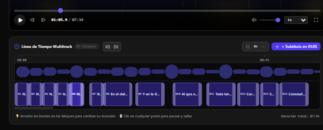

# 🎬 SubCraft AI Studio Pro

[](https://github.com/peaceiris/actions-gh-pages)
[](https://vite-pwa-org.netlify.app/)

Un estudio web profesional para la **creación, edición sincronizada y exportación de subtítulos** para videos de 5 a 10 minutos (MP4, WebM, MOV o enlaces directos de YouTube).



---

## ✨ Características Principales

- ⏱️ **Línea de Tiempo Multitrack Táctil e Interactiva**:
  - **Bloques arrastrables y redimensionables**: Ajusta el inicio y fin de cada subtítulo arrastrando los bordes directamente en la pista.
  - **Desplazamiento Automático (Ripple Shift)**: Al añadir un nuevo bloque, los subtítulos posteriores se recorren automáticamente sin colisiones.
  - **Auto-centrado de Zoom**: Haz Zoom (`1x`, `2x`, `4x`, `8x`) sin perder de vista el cabezal de reproducción.
  - **Deslizador de Navegación Global**: Recorre todo el video (00:00 a final) fluidamente.

- 🤖 **Motor de Subtítulos Algorítmico 100% Local (Sin IA)**:
  - Generación de bloques de subtítulos divididos en frases cortas de 6 a 8 palabras, distribuidos de manera rítmica según la duración del video.
  - Permite ingresar un guión o letra completa y fragmentarla en múltiples recuadros sincronizados.

- 🎵 **Modo "Solo Audio" & 5 Fondos Animados a 60 FPS**:
  - *Aurora Fluid Gradient*, *Synthwave 3D Grid*, *Cosmic Nebula*, *Sound Spectrum Visualizer* y *Lo-Fi Midnight Rain*.
  - Espectro reactivo de ondas de sonido superpuesto y modo de subtítulos a pantalla completa.

- 📱 **Formatos Multiplataforma**:
  - Conmutador instantáneo entre **16:9** (Horizontal / YouTube), **9:16** (Vertical / TikTok & Reels) y **1:1** (Cuadrado / Feed).

- 💾 **Sincronización en la Nube & Guardado de Proyectos**:
  - Integración con Firebase Authentication y Firestore Cloud para sincronizar múltiples dispositivos.
  - Botón de **Guardar Proyecto** instantáneo con notificaciones toast.

- 📥 **Exportación Profesional**:
  - Descarga en formatos **.SRT** y **.VTT**.
  - Renderizado e integración de subtítulos quemados en video **1080p** de alta resolución directamente en el navegador.

---

## 🚀 Instalación Local

### Requisitos Previos
- Node.js versión 18 o superior
- npm versión 9 o superior

### Pasos
1. Clona el repositorio:
   ```bash
   git clone https://github.com/TU_USUARIO/subcraft-ai-studio.git
   cd subcraft-ai-studio
   ```

2. Instala las dependencias:
   ```bash
   npm install
   ```

3. Inicia el servidor de desarrollo en el puerto 3000:
   ```bash
   npm run dev
   ```
   Abre [http://localhost:3000](http://localhost:3000) en tu navegador.

---

## 🌐 Publicar en GitHub Pages

Este repositorio incluye un flujo de trabajo automático de **GitHub Actions** (`.github/workflows/deploy.yml`).

### Instrucciones para Publicar:

1. Crea tu repositorio en GitHub y sube el código:
   ```bash
   git init
   git add .
   git commit -m "Initial commit: SubCraft AI Studio Pro"
   git branch -M main
   git remote add origin https://github.com/TU_USUARIO/subcraft-ai-studio.git
   git push -u origin main
   ```

2. En GitHub, ve a la pestaña de tu repositorio: **Settings** -> **Pages**.
3. En **Source**, selecciona **GitHub Actions**.
4. ¡Listo! Cada vez que hagas `push` a la rama `main`, GitHub compilará y publicará automáticamente tu aplicación en:
   `https://TU_USUARIO.github.io/subcraft-ai-studio/`

---

## 🛠️ Tecnologías Utilizadas

- **React 19** & **TypeScript**
- **Vite 8**
- **Tailwind CSS v4**
- **Lucide React Icons**
- **Firebase Auth & Firestore**
- **Canvas API 2D** (Renderizado 60 FPS y quemado de video 1080p)

---

## 📄 Licencia

Este proyecto está bajo la Licencia Apache 2.0.
